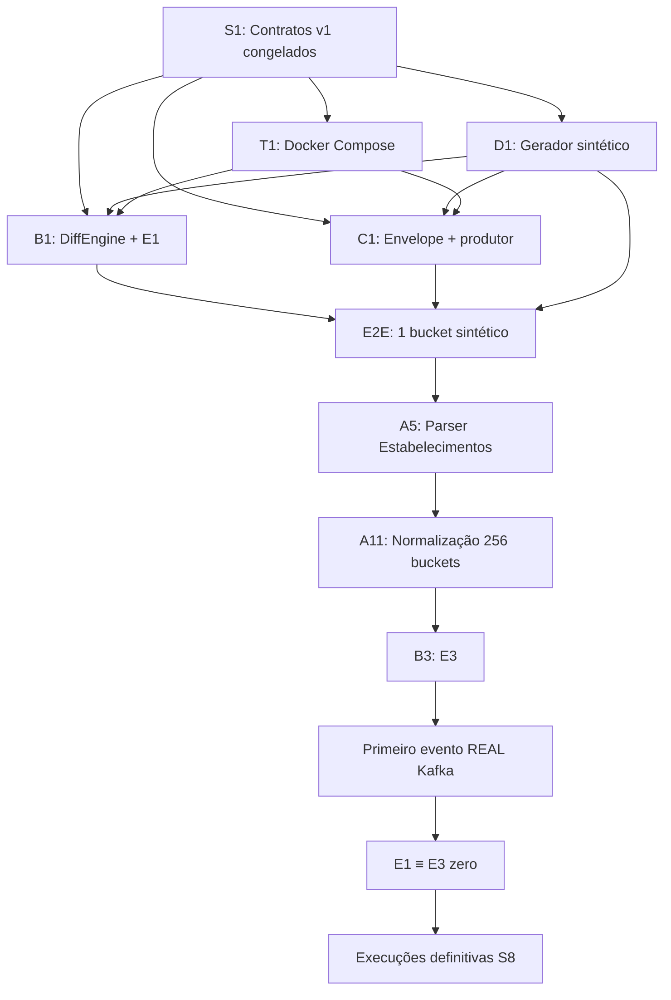

# CDC-CNPJ — Plano Mestre de Implementação

> **For agentic workers:** REQUIRED SUB-SKILL: Use superpowers:subagent-driven-development (recommended) or superpowers:executing-plans to implement this plan task-by-task. Steps use checkbox (`- [ ]`) syntax for tracking.

**Goal:** Construir um pipeline reprodutível que converte snapshots mensais do CNPJ (2026-06 e 2026-07) em eventos tipados no Kafka, comparando os motores E1 (Postgres) e E3 (hash particionado) sobre 16 dos 256 buckets.

**Architecture:** Cinco estágios desacoplados (ingestão → normalização Parquet → diff → eventos Kafka → consumer Postgres), quatro frentes paralelas (A/B/C/D) comunicando-se **somente** por Parquet e Kafka. Normalização escreve os 256 buckets; experimento de diff roda sobre amostra de 16. Contratos congelados na S1 destravam fixtures sintéticas na S2.

**Tech Stack:** Java 21 · Spring Boot · Apache Parquet · Apache Kafka · PostgreSQL · Docker Compose · Micrometer · Maven

**Spec:** [`docs/superpowers/specs/2026-08-18-cdc-cnpj-design.md`](../specs/2026-08-18-cdc-cnpj-design.md)

## Global Constraints

- CNPJ é **String** em toda a stack — nunca `long`, `int`, `BIGINT`, `parseInt` (R1)
- Partição: `bucket(cnpj_basico) = murmur3_32(utf8(cnpj_basico)) mod 256`, normalizada não-negativa — nunca `String.hashCode()` (R2)
- **Nunca** materializar CSV descompactado em disco — streaming ZIP → Parquet (R3)
- Taxa de rejeição > **0,1%** faz o estágio falhar; sem `catch` silencioso em parsing (R4)
- Snapshots normalizados são **imutáveis** — reprocessar da origem, nunca consertar Parquet no lugar (R5)
- `event_id = uuid_v5(...)` determinístico — nunca `UUID.randomUUID()` (R6)
- Dependência nova só com ADR (R7)
- Pipeline roda **nativo na JVM**; só Postgres e Kafka em Docker
- Build e teste rodam **no módulo**, nunca na raiz
- Expansão bloqueada até Núcleo 30/30

---

## Análise da ideia (síntese executiva)

### Por que a ideia é sólida

| Força | Evidência no projeto |
|---|---|
| Problema real e mal atendido | Receita publica fotografia mensal (~85 GB), sem delta nem API |
| Posicionamento científico claro | Snapshot differencing (Labio & Garcia-Molina, 1996) como âncora; CDC clássico como contraponto |
| Escopo cortado com honestidade | ADR-001: vertical fino, 16/256 buckets, dois motores — sustentável em 468 h |
| Validação sem gabarito oficial | E1≡E3 + amostra de 200 + invariantes — metodologia publicável |
| Desacoplamento de frentes | Parquet + Kafka permitem 4 pessoas em paralelo após S1 |
| Reprodutibilidade como requisito | Manifesto SHA-256, protocolo documentado, dados brutos de medição |

### Riscos principais (e mitigação já prevista)

| Risco | Mitigação no plano |
|---|---|
| Parser silenciosamente errado | Contadores + limite 0,1% desde S2; comparar com minha-receita |
| Download atrasa tudo | Iniciar na S1; plano B: só Estabelecimentos (21/set) |
| E1≡E3 diverge | `event_id` determinístico → comparação de conjuntos; teste CI contínuo |
| Disco insuficiente | Streaming obrigatório; 256 buckets Parquet, não CSV |
| Contratos divergentes | Congelar CONTRATOS.md **antes** de codar motores/eventos |
| Time pequeno (4×9 h/sem) | Gerador sintético (D1) na S2 destrava B e C sem dado real |

### Estado atual (2026-08-27)

- Documentação: spec, escopo, contratos (rascunho), Atividade 01 pronta
- Código: **zero** — nenhum módulo Maven ainda
- Harness: CONTRATOS não congelados; ESCOPO/STATUS desatualizados (>7 dias)
- Marco imediato perdido: contratos v1 (24/ago) — **recuperar esta semana**

---

## Estrutura de módulos Maven (proposta)

```
cdc-cnpj/                          (parent POM)
├── cdc-cnpj-common/               # R1, R2, R6, tipos compartilhados
├── cdc-cnpj-ingestion/            # Frente A — download, manifesto, parsers
├── cdc-cnpj-diff/                 # Frente B — DiffEngine, E1, E3
├── cdc-cnpj-events/               # Frente C — envelope, produtor, consumer
├── cdc-cnpj-bench/                # Frente D — gerador sintético, harness
├── docker-compose.yml             # Postgres + Kafka
├── data/                          # gitignored — canonical/, raw/, fixtures/
└── scripts/
    ├── harness_check.py
    └── run-experiment.sh          # S8 — execuções definitivas
```

**Interfaces congeladas entre módulos:**

| Produz | Consome | Artefato |
|---|---|---|
| A | B, C, D | Parquet em `data/canonical/competencia=…/tabela=…/bucket=…/` |
| B | C | `Stream<ChangeRecord>` (tipo em `common`) |
| C | consumer, D | JSON no Kafka; changelog em Postgres |
| D | B, C, A | Fixtures em `data/fixtures/` + gerador programático |

---

## Mapa de dependências entre frentes



---

## Fase 0 — Recuperação imediata (esta semana)

Antes de qualquer código, fechar o que a S1 prometeu.

- [ ] Atualizar `docs/STATUS.md` e `docs/ESCOPO.md` (data + estado real)
- [ ] Ler `cnpj-metadados.pdf` + ETL `cuducos/minha-receita`
- [ ] Preencher schemas Parquet em `docs/CONTRATOS.md` §3.5 (empresas, estabelecimentos, domínio)
- [ ] Fechar taxonomia de eventos e grupos de campos em `docs/CONTRATOS.md` §4.3
- [ ] Definir `ChangeRecord` e assinatura final de `DiffEngine` em `docs/CONTRATOS.md` §5
- [ ] Definir formato `manifesto.json` em `docs/CONTRATOS.md` §6
- [ ] Ratificar ADR-003 (título) com as 4 frentes
- [ ] Marcar `ESTADO_CONTRATO: CONGELADO` em CONTRATOS.md
- [ ] Distribuir leitura das 8 obras (2 por integrante) — Atividade 01
- [ ] Iniciar download 2026-06 e 2026-07 (background)
- [ ] Atribuir frentes A/B/C/D por integrante

**Critério de saída:** `python scripts/harness_check.py` sem erros; CONTRATOS congelado.

---

## Fase 1 — Fundação técnica (S1 fim / início S2)

### Task 1: Parent POM e módulo common

**Files:**
- Create: `pom.xml`, `cdc-cnpj-common/pom.xml`
- Create: `cdc-cnpj-common/src/main/java/.../partition/CnpjPartitioner.java`
- Create: `cdc-cnpj-common/src/main/java/.../cnpj/CnpjValidator.java`
- Create: `cdc-cnpj-common/src/main/java/.../event/EventIdGenerator.java`
- Create: `cdc-cnpj-common/src/main/java/.../diff/ChangeRecord.java`
- Create: `cdc-cnpj-common/src/main/java/.../diff/DiffEngine.java`
- Test: `cdc-cnpj-common/src/test/java/.../partition/CnpjPartitionerTest.java`
- Test: `cdc-cnpj-common/src/test/java/.../cnpj/CnpjValidatorTest.java`
- Test: `cdc-cnpj-common/src/test/java/.../event/EventIdGeneratorTest.java`

**Interfaces:**
- Produces: `CnpjPartitioner.bucket(String cnpjBasico) -> int` (0–255)
- Produces: `EventIdGenerator.generate(...) -> UUID` (uuid v5)
- Produces: `ChangeRecord`, `DiffEngine` interface conforme CONTRATOS §5

- [ ] **Step 1:** Parent POM Java 21, dependências: guava (murmur3), parquet, junit5
- [ ] **Step 2:** Testes com vetores fixos de partição (copiar de CONTRATOS §1)
- [ ] **Step 3:** Implementar `CnpjPartitioner` com murmur3_32 mod 256
- [ ] **Step 4:** Testes dígito verificador CNPJ alfanumérico (formato misto ASCII−48)
- [ ] **Step 5:** Implementar validação CNPJ string
- [ ] **Step 6:** Testes `event_id` determinístico — mesma entrada → mesmo UUID
- [ ] **Step 7:** Implementar `EventIdGenerator` + namespace UUID fixo
- [ ] **Step 8:** Definir `ChangeRecord` e interface `DiffEngine`
- [ ] **Step 9:** `mvn -pl cdc-cnpj-common test` — PASS
- [ ] **Step 10:** Atualizar ESCOPO (B1 parcial) e STATUS

### Task 2: Docker Compose (T1)

**Files:**
- Create: `docker-compose.yml`
- Create: `infra/postgres/init.sql`
- Create: `infra/kafka/README.md` (tópicos esperados)

- [ ] **Step 1:** Postgres 16 + volume persistente + schema `changelog`
- [ ] **Step 2:** Kafka (KRaft ou Bitnami) + tópicos `cnpj.empresas`, `cnpj.estabelecimentos`, `cnpj.dominio`
- [ ] **Step 3:** Healthcheck; documentar portas no README
- [ ] **Step 4:** Smoke test: produtor/consumidor mínimo conecta
- [ ] **Step 5:** Atualizar ESCOPO T1 → `[x]`

### Task 3: Gerador sintético (D1) — destrava S2

**Files:**
- Create: `cdc-cnpj-bench/pom.xml`
- Create: `cdc-cnpj-bench/src/main/java/.../SyntheticSnapshotGenerator.java`
- Create: `cdc-cnpj-bench/src/main/java/.../FixtureWriter.java`
- Test: `cdc-cnpj-bench/src/test/java/.../SyntheticSnapshotGeneratorTest.java`

**Interfaces:**
- Produces: Parquet fixtures em `data/fixtures/competencia=…/` com 256 buckets (pode ser pequeno)
- Produces: manifesto de fixture com contagem conhecida de mudanças por tipo

- [ ] **Step 1:** Gerar N registros com `cnpj_basico` string + distribuição em buckets
- [ ] **Step 2:** Segundo snapshot com mudanças controladas (criação, remoção, alteração por grupo de campos)
- [ ] **Step 3:** Teste de propriedade: conjunto esperado de mudanças documentado no teste
- [ ] **Step 4:** Escrever fixtures compartilhadas; commitar só manifesto + README (Parquet gitignored)
- [ ] **Step 5:** Atualizar ESCOPO D1, T2 → `[x]`

**Marco Fase 1:** common testado + infra sobe + fixtures existem.

---

## Fase 2 — Um bucket ponta a ponta sintético (S2–S3, até 07/set)

Ordem de implementação (Estabelecimentos primeiro — parser mais difícil):

### Task 4: E1 baseline (B2)

**Files:**
- Create: `cdc-cnpj-diff/pom.xml`
- Create: `cdc-cnpj-diff/src/main/java/.../e1/PostgresDiffEngine.java`
- Test: `cdc-cnpj-diff/src/test/java/.../e1/PostgresDiffEngineIntegrationTest.java`

- [ ] **Step 1:** Teste de integração contra fixture bucket=000 — FULL OUTER JOIN por chave natural
- [ ] **Step 2:** Implementar carga bucket-a-bucket em temp tables
- [ ] **Step 3:** Emitir `ChangeRecord` (insert/delete/update + campos_alterados)
- [ ] **Step 4:** Verificar determinismo do conteúdo que alimentará `event_id`
- [ ] **Step 5:** ESCOPO B2 → `[x]`

### Task 5: Produtor + consumer mínimo (C2–C5 parcial)

**Files:**
- Create: `cdc-cnpj-events/pom.xml`
- Create: `cdc-cnpj-events/src/main/resources/schemas/event-envelope-1.0.json`
- Create: `cdc-cnpj-events/src/main/java/.../EventMapper.java`
- Create: `cdc-cnpj-events/src/main/java/.../KafkaEventProducer.java`
- Create: `cdc-cnpj-events/src/main/java/.../ChangelogConsumer.java`

- [ ] **Step 1:** JSON Schema versionado conforme CONTRATOS §4
- [ ] **Step 2:** Mapear `ChangeRecord` → envelope tipado (taxonomia mínima)
- [ ] **Step 3:** Publicar no Kafka com key=`cnpj_basico`
- [ ] **Step 4:** Consumer idempotente por `event_id` → Postgres changelog
- [ ] **Step 5:** Teste integração: fixture → E1 → Kafka → Postgres
- [ ] **Step 6:** ESCOPO C1–C5 parcial → `[x]` onde aplicável

### Task 6: Parser Estabelecimentos streaming (A5)

**Files:**
- Create: `cdc-cnpj-ingestion/pom.xml`
- Create: `cdc-cnpj-ingestion/src/main/java/.../parser/EstabelecimentosParser.java`
- Create: `cdc-cnpj-ingestion/src/main/java/.../normalize/ParquetWriter.java`
- Test: `cdc-cnpj-ingestion/src/test/java/.../parser/CsvLineParserTest.java`
- Test: `cdc-cnpj-ingestion/src/test/java/.../parser/EstabelecimentosParserTest.java`

- [ ] **Step 1:** Testes unitários CSV posicional — aspas, `;` embutido, encoding
- [ ] **Step 2:** Parser linha a linha sem materializar CSV
- [ ] **Step 3:** Escrita Parquet com schema explícito + colunas proveniência
- [ ] **Step 4:** Particionamento 256 buckets na escrita
- [ ] **Step 5:** Contadores lidas/rejeitadas; falha se > 0,1%
- [ ] **Step 6:** ESCOPO A5 → `[x]`

**Marco Fase 2 (07/set):** `SyntheticSnapshot → Parquet → E1 → Kafka → Postgres` funciona para 1 bucket.

---

## Fase 3 — Dado real e E3 (S4–S5, até 21/set)

### Task 7: Ingestão completa (A1–A4, A6–A11)

- [ ] Download + manifesto SHA-256 (A1–A3)
- [ ] Teste de contrato layout Receita (A4)
- [ ] Parsers Empresas + domínio + ponte tabmun (A6–A8)
- [ ] Normalização 2 competências × 256 buckets (A9–A11)
- [ ] Comparar contagens com referência externa

### Task 8: Motor E3 (B3–B4)

- [ ] Hash de conteúdo por registro + diff em memória por bucket
- [ ] Paralelismo entre buckets (limite de memória = maior bucket)
- [ ] Preenchimento `campos_alterados` idêntico ao E1

### Task 9: Taxonomia completa de eventos (C3)

- [ ] Regras de precedência: `situacao_alterada`, `endereco_alterado`, `cnae_alterado` vs `*.alterado`
- [ ] Tópicos por entidade

**Marco Fase 3 (21/set):** primeiro evento **REAL** no Kafka. Plano B se falhar: só Estabelecimentos.

---

## Fase 4 — Equivalência e caracterização (S6–S7, até 05/out)

### Task 10: Teste E1 ≡ E3 (B5)

**Files:**
- Test: `cdc-cnpj-diff/src/test/java/.../EquivalenceIT.java`

```java
// Métrica: |symmetricDifference| / |union| == 0
Set<UUID> e1 = runEngine("E1", buckets);
Set<UUID> e3 = runEngine("E3", buckets);
assertEquals(e1, e3);
```

- [ ] Rodar sobre 16 buckets × fixtures e dado real
- [ ] Qualquer divergência = bug bloqueante

### Task 11: Caracterização (D4, D6)

- [ ] Contagem por tabela, taxa de mudança por tipo de evento
- [ ] Invariantes de sanidade com tolerância declarada
- [ ] Verificação representatividade 16 vs 256 buckets (D7)

**Marco Fase 4 (05/out):** E1≡E3 diferença simétrica zero.

---

## Fase 5 — Experimento definitivo (S8, até 12/out)

### Task 12: Harness de medição (D2–D3)

- [ ] Micrometer + RSS/heap/I/O por execução
- [ ] Matriz: 5 repetições × {E1,E3} × {1,4,8,16 buckets}, descartando 1ª
- [ ] Mediana + IQR; speedup, escalabilidade memória, custo projetado
- [ ] Validação amostral 200 eventos, semente registrada (D5)

**Marco Fase 5 (12/out):** CONGELAMENTO DE ESCOPO — Núcleo 30/30.

---

## Fase 6 — Expansão opcional (S9–S11)

Somente se Núcleo fechado. Ordem obrigatória:

1. X1 — 256 buckets completos (valida H2 direto)
2. X2 — Sócios + P2
3. X3 — Simples
4. X4 — Quarentena deletes

---

## Distribuição sugerida por integrante

| Integrante | Frente primária | S2–S3 foco | S4+ foco |
|---|---|---|---|
| P1 | A | Parser Estabelecimentos + ingestão | Normalização completa |
| P2 | B | E1 + fixtures | E3 + E1≡E3 |
| P3 | C | Envelope + Kafka + consumer | Taxonomia + changelog QA |
| P4 | D | Gerador sintético + Docker | Harness + caracterização + gráficos |

Todos participam do congelamento de contratos na Fase 0.

---

## Self-review (spec coverage)

| Requisito spec | Task no plano |
|---|---|
| §5.1 Núcleo completo | Fases 0–5 |
| §6.1 Streaming sem CSV | Task 6, Task 7 |
| §6.2 D1–D4 congelados | Task 1 (common) |
| §8 E1 e E3 | Task 4, Task 8 |
| §9 Protocolo experimental | Task 12 |
| §10 Validação 3 camadas | Task 10, Task 11, Task 12 |
| §11 Ordem de testes | Task 1, 3, 4, 10 |
| §13 Critérios de corte | Marcos datados em cada fase |
| Gerador sintético S2 | Task 3 |

**Gaps:** nenhum requisito do Núcleo ficou sem task. Detalhamento TDD linha-a-linha fica nos planos filhos por fase (próximo passo recomendado).

---

## Planos filhos recomendados (próximos documentos)

| Plano | Escopo | Quando |
|---|---|---|
| `2026-08-27-phase0-contracts-freeze.md` | Fechar CONTRATOS + recuperar S1 | **Agora** |
| `2026-08-27-phase1-foundation.md` | Tasks 1–3 com steps TDD completos | Após contratos |
| `2026-09-01-phase2-synthetic-e2e.md` | Tasks 4–6 | Após Fase 1 |
| `2026-09-08-phase3-real-data.md` | Tasks 7–9 | Após bucket sintético |

---

## Verificação contínua

Antes de cada sessão:

```bash
python scripts/harness_check.py
```

Após cada task:

```bash
mvn -pl <modulo> test
# Atualizar docs/ESCOPO.md e docs/STATUS.md
# ADR em docs/DECISOES.md se decidir algo divergente
```
